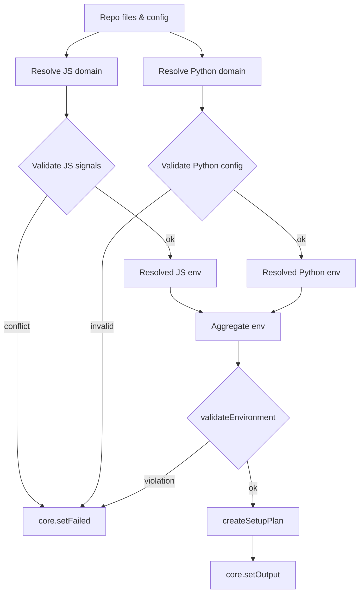

# Environment Resolution

How the actions detect a repository's runtimes, package managers, and toolchains. Implemented in `src/resolve-environment.ts` (orchestration), `src/javascript-env.ts`, `src/python-env.ts`, and `src/setup-plan.ts` — those modules and their tests in `tests/` are the authoritative specification for exact behavior.

## Domains

JavaScript/TypeScript and Python resolve independently. A repo may contain either, both, or neither. When neither is detected, resolution logs `No JavaScript or Python environment detected.` and succeeds.

## Resolution Flow

`run()` in `src/resolve-environment.ts` executes sequentially:

## Rules

- **Delegated version resolution** — `actions/setup-node`, `pnpm/setup`, `oven-sh/setup-bun`, `actions/setup-python`, `astral-sh/setup-uv`, and `astral-sh/ruff-action` own version selection and installation. When `pnpm` is selected, `pnpm/setup` provisions it (and the runtime) directly, so the node/bun setup steps are skipped to avoid duplicate setup.
- **Runtime precedence** — `devEngines` declarations, then version files (`.bun-version` vs `.nvmrc`/`.node-version`), then package manager (`bun`), else Node.js. Contradictory signals (e.g. bun + node config) fail validation rather than applying a silent tie-breaker.
- **Package manager precedence** — `packageManager` field, then `devEngines.packageManager`, then lockfiles (`pnpm-lock.yaml`, `package-lock.json`, `bun.lock`), else `npm`.
- **Toolchain** — `vite-plus` is the recognized toolchain, detected from a Vite+ dependency in `package.json`.
- **Python package manager** — `pip` by default; `uv` when `uv.lock` or explicit uv config in `pyproject.toml` (`[tool.uv]` with workspace or dev-dependencies) is present. `uv.lock` without a valid `pyproject.toml` is an error. `uv.toml` is not currently recognized as a project manifest.
- **Pure setup plan** — `createSetupPlan(env)` is a pure transform (no filesystem access, no side effects) derived from the resolved environment, guaranteeing plan/environment consistency.

## Conflict Handling

- Valid config → explicit runtime/package-manager/toolchain outputs.
- Undetected domain → `detected: false`, no error.
- Contradictory config or invariant violation (e.g. lockfile without required manifest) → `core.setFailed` and halt.

## Maintenance

When resolution behavior changes:

- Update `src/` and add or update tests in `tests/`.
- Keep this document's mermaid flow and rules in sync.
- Update the `README.md` / `pages/README.md` / `autofix/README.md` references if entrypoints change.

## Python Autofix Lifecycle

The Python Autofix provider (`src/autofix/providers/python.ts`) follows a specific lifecycle that separates **Python project detection** from **Python source detection**:

### Python Project Detection

- Determines whether the repository is a Python project based on dependency configuration **or Python source code**.
- Recognizes: `pyproject.toml` with `[project]` or `[build-system]`, `uv.lock`, `requirements.txt`, `setup.py`, `setup.cfg`, `[tool.uv]` configuration in `pyproject.toml` (when it defines a workspace or dev-dependencies).
- Also detects Python projects when `.py`/`.pyi` source files are present, even without dependency manifests.
- `uv.toml` is not currently recognized as a project manifest.
- A project is detected even when no `.py`/`.pyi` source files exist.
- Used to decide whether to install/synchronize dependencies.

### Python Source Detection

- Determines whether Python source code exists (`.py`/`.pyi` files anywhere in the repo, including test directories).
- Used to decide whether to execute Ruff lint/format tasks.

### Execution Order

The GitHub Actions workflow executes in this order:

1. **Environment setup** — GitHub Actions provisions Python runtime and package manager (`actions/setup-python` or `astral-sh/setup-uv`).
2. **Ruff setup** — `astral-sh/ruff-action` provisions Ruff executable.
3. **Run autofix** — The autofix runner executes the Python provider lifecycle:
   a. **Dependency installation** — Runs `uv sync` (for uv projects) or `pip install` (for pip projects) automatically. This happens for ALL detected Python projects, regardless of whether source files exist.
   - For uv: `uv sync` is used without `--locked`, `--frozen`, or `--upgrade`. This allows uv to update `uv.lock` when synchronization requires it.
   - For pip: Dependencies are installed from detected configuration (`requirements.txt`, `pyproject.toml` `[project]`, `setup.py`, `setup.cfg`). Pip does not generate or update lockfiles.
     b. **Ruff lint autofix** — Runs `ruff check --fix .` **only when Python source files are detected**.
     c. **Ruff formatting** — Runs `ruff format .` **only when Python source files are detected**, after lint autofix.

Note: Dependency installation occurs inside the Python provider during the "Run autofix" step, not during the GitHub Actions setup steps. This ensures installation happens after the runtime and package manager are provisioned, and before Ruff executes.

### Key Behaviors

- Dependency installation is **independent of Ruff execution**. A Python project with `uv.lock` but no `.py` files will still run `uv sync`.
- If dependency installation fails, Ruff does **not** execute. The action fails with the dependency installation error.
- JavaScript-only repositories never trigger Python setup or dependency installation.
- The `python-detected` output from environment resolution indicates a Python **project or Python source code** was detected. The `python-source-detected` output indicates specifically whether Python source files (`.py`/`.pyi`) were found.

### uv Lockfile Behavior

- `uv sync` is the single command used for uv projects.
- It automatically updates `uv.lock` when the lockfile is missing or outdated relative to `pyproject.toml`.
- No separate `uv lock` command is run.
- No `--locked`, `--frozen`, or `--upgrade` flags are used by default.

### pip Behavior

- Installs from detected configuration files.
- Does not generate or update lockfiles.
- Standalone projects (no dependency configuration) skip installation entirely.
