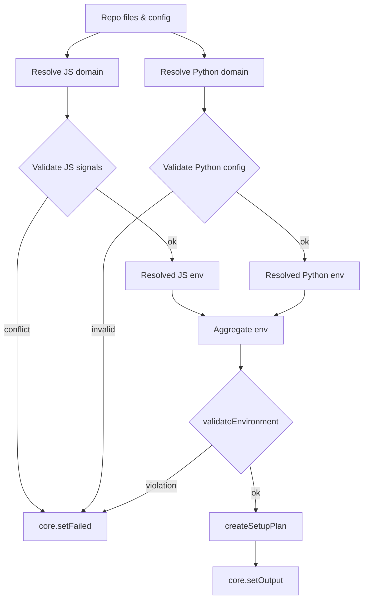

# Environment Resolution

How the actions detect a repository's runtimes, package managers, and toolchains. Implemented in `src/resolve-environment.ts` (orchestration), `src/javascript-env.ts`, `src/python-env.ts`, and `src/setup-plan.ts` — those modules and their tests in `tests/` are the authoritative specification for exact behavior.

## Domains

JavaScript/TypeScript and Python resolve independently. A repo may contain either, both, or neither. When neither is detected, resolution logs `No JavaScript or Python environment detected.` and succeeds.

## Resolution

`run()` in `src/resolve-environment.ts` runs sequentially:

## Rules

- **Delegated version resolution** — `actions/setup-node`, `pnpm/setup`, `oven-sh/setup-bun`, `actions/setup-python`, `astral-sh/setup-uv`, and `astral-sh/ruff-action` own version selection and installation. When `pnpm` is selected, `pnpm/setup` provisions it (and the runtime) directly, so the node/bun setup steps are skipped to avoid duplicate setup.
- **Runtime precedence** — `devEngines` declarations, then version files (`.bun-version` vs `.nvmrc`/`.node-version`), then package manager (`bun`), else Node.js. Contradictory signals (e.g. bun + node config) fail validation rather than applying a silent tie-breaker.
- **Package manager precedence** — `packageManager` field, then `devEngines.packageManager`, then lockfiles (`pnpm-lock.yaml`, `package-lock.json`, `bun.lock`), else `npm`.
- **Toolchain** — `vite-plus` is the only recognized toolchain, detected from a Vite+ dependency in `package.json` (or an explicit input). Standard Vite is not a toolchain. When Vite+ is absent the toolchain line is omitted.
- **Python package manager** — `pip` by default; `uv` when `uv.lock` or explicit uv config (`[tool.uv]` / `uv.toml`) is present. `uv.lock` without a valid `pyproject.toml` is an error.
- **Pure setup plan** — `createSetupPlan(env)` is a pure transform (no filesystem access, no side effects) derived from the resolved environment, guaranteeing plan/environment consistency.

## Conflict handling

- Valid config → explicit runtime/package-manager/toolchain outputs.
- Undetected domain → `detected: false`, no error.
- Contradictory config or invariant violation (e.g. lockfile without required manifest) → `core.setFailed` and halt.

## Maintenance

When resolution behavior changes:

- Update `src/` and add or update tests in `tests/`.
- Keep this document's mermaid flow and rules in sync.
- Update the `README.md` / `pages/README.md` / `autofix/README.md` references if entrypoints change.
