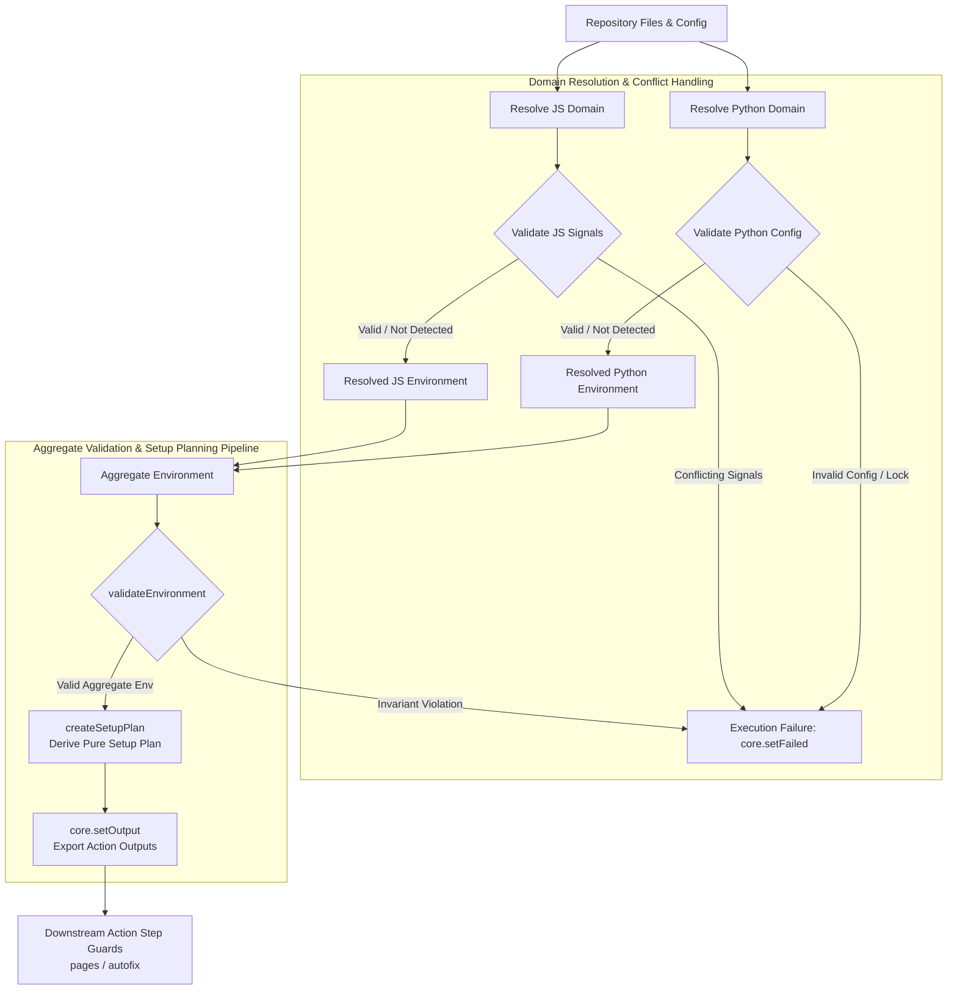

# Environment Resolution Algorithm Guide

This guide explains the design principles, decision flow, conflict handling, and maintenance rules for repository environment resolution in `@area44/workflows`.

---

## Purpose and Scope

Environment resolution is the initial phase of composite action execution (`pages` and `autofix`). It inspects a repository's configuration and source files, resolves the effective execution environment, derives a deterministic tool setup plan, and exports GitHub Actions outputs for downstream execution steps.

Environment resolution determines which runtimes, package managers, and toolchains a repository targets. Official setup actions (`actions/setup-node`, `pnpm/setup`, `oven-sh/setup-bun`, `actions/setup-python`, `astral-sh/ruff-action`) natively handle runtime and tool version selection and installation according to their documented capabilities. Downstream composite action steps execute builds, dependency installations, and autofix commands based on the exported outputs without mutating repository files.

---

## Core Principles

- **Domain Independence**: JavaScript/TypeScript and Python project resolution operate as independent domains. Repositories can contain JavaScript, Python, both, or neither. When neither domain is detected, the standalone plain-text message `No JavaScript or Python environment detected.` is emitted and resolution continues without error.
- **Delegated Version Resolution**: Official setup actions own runtime and tool version selection and installation. `pnpm/setup` manages pnpm and runtime setup directly when `pnpm` is selected, bypassing dedicated Node.js/Bun setup steps to prevent duplicate setup. TypeScript detects ecosystem presence, selects package managers and toolchains, and coordinates setup orchestration without parsing version files.
- **Toolchain Classification**: Vite+ is the only supported JavaScript toolchain (`Toolchain: Vite+`). Standard Vite alone is not classified or reported as a toolchain. When Vite+ is not detected, the `Toolchain` line is omitted entirely.
- **Python Package Manager Selection**: Default package manager is `pip`. `uv` is selected when `uv.lock` or explicit `uv` configuration (`[tool.uv]` table or `uv.toml`) is detected.
- **Plain-Text Summary Logging**: Summary logs use plain-text output in category order (`Runtime`, `Package Manager`, `Toolchain`).
- **Explicit Conflict Validation**: Contradictory configuration declarations across manifest files and package managers trigger immediate validation errors rather than applying silent tie-breakers.
- **Pure Setup Planning**: Environment resolution and filesystem inspection are strictly separated from setup plan generation. Setup plans are derived through a pure, deterministic transformation layer with zero filesystem access or action side effects.

---

## Resolution Algorithm

The environment resolution entrypoint (`run()` in `src/resolve-environment.ts`) executes environment discovery, domain resolution, aggregate validation, setup planning, and output export sequentially:

---

## Conflict Handling

The algorithm distinguishes clearly between missing information (handled by deterministic defaults) and invalid or contradictory configuration (which halts step execution):

- **Successful Resolution**: Valid, non-contradictory configuration signals are resolved to explicit runtime, package manager, and toolchain settings.
- **Undetected Domains**: Absent project files or source code return valid `detected: false` states without error. When neither domain is detected, an informational log is emitted and resolution completes successfully.
- **Conflicting Signals**: Contradictory declarations (such as declaring conflicting runtimes across configuration files) fail validation immediately and halt execution with an error annotation (`core.setFailed`).
- **Invalid Configuration State**: Invariant violations (such as lockfiles existing without required project configuration or malformed aggregate environments) trigger explicit error messages and halt execution.

---

## Maintenance

When modifying or extending the environment resolution algorithm:

- **Implementation as Authority**: The source code and automated test suites serve as the authoritative specification for exact behavioral details and edge cases.
- **Automated Test Coverage**: Add or update automated tests in `__tests__/` when resolution logic or edge-case handling changes.
- **Documentation Synchronization**: Keep the Mermaid flowchart and core principles in this document synchronized with implementation changes, and ensure README references remain accurate.
