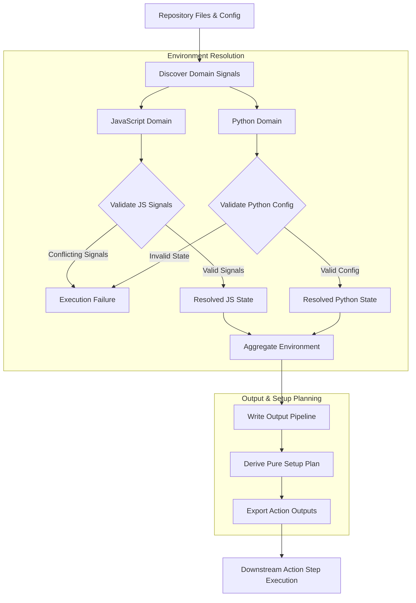

# Environment Resolution Algorithm Guide

This guide explains the design principles, decision flow, conflict handling, and maintenance rules for repository environment resolution in `@area44/workflows`.

---

## Purpose and Scope

Environment resolution is the initial phase of composite action execution (`pages` and `autofix`). It inspects a repository's configuration and source files, resolves the effective execution environment, derives a deterministic tool setup plan, and exports GitHub Actions outputs for downstream execution steps.

Environment resolution determines which runtimes and package managers a repository targets. Downstream composite action steps execute builds, dependency installations, and autofix commands based on the exported outputs without mutating repository files.

---

## Core Principles

- **Domain Independence**: JavaScript/TypeScript and Python project resolution operate as independent domains. A repository can contain JavaScript, Python, both, or neither.
- **Explicit Conflict Validation**: Contradictory configuration declarations across manifest files, version files, and package managers trigger immediate validation errors rather than applying silent tie-breakers.
- **Pure Setup Planning**: Environment resolution and filesystem inspection are strictly separated from setup plan generation. Setup plans are derived through a pure, deterministic transformation layer with zero filesystem access or action side effects.
- **Specifier Preservation**: Explicitly declared version specifiers (such as `latest` or exact version pins) are preserved through resolution rather than overwritten by default values.
- **Context-Appropriate Defaults**: When explicit configuration is absent, the resolver applies deterministic defaults appropriate to the detected environment.

---

## Resolution Algorithm

The environment resolution pipeline executes domain discovery, conflict validation, aggregate environment construction, setup planning, and output export sequentially:

### Conceptual Resolution Stages

1. **Signal Discovery**: Scans the repository for project configuration files, runtime version declarations, package manager manifests, lockfiles, and Python source files.
2. **Conflict Validation & Domain Resolution**: Validates collected signals for contradictory runtime declarations or invalid lockfile states. If signals are valid, resolves the target runtimes, package managers, toolchains, and versions independently for each domain.
3. **Aggregate Environment Validation**: Combines domain outcomes into a single aggregate environment structure and asserts structural validity.
4. **Setup Planning & Output Export**: Derives a pure setup plan determining which setup actions are required for the resolved environment, then exports internal setup control flags and public ecosystem outputs to GitHub Actions runner context.
5. **Action Step Guard Evaluation**: Downstream composite action steps evaluate output conditions to conditionally provision toolchains and execute workflow tasks.

---

## Conflict Handling

The algorithm distinguishes clearly between missing information (handled by deterministic defaults) and invalid or contradictory configuration (which halts step execution):

- **Successful Resolution**: Valid, non-contradictory configuration signals are resolved to explicit runtime, package manager, version, and toolchain settings.
- **Missing Information**: Absent manifest files or unspecified versions apply context-appropriate default versions without error.
- **Conflicting Signals**: Contradictory declarations (such as declaring conflicting runtimes across configuration files) fail validation immediately and halt execution with an error annotation.
- **Invalid Configuration State**: Invariant violations (such as lockfiles existing without required project configuration) trigger explicit error messages and halt execution.

---

## Maintenance

When modifying or extending the environment resolution algorithm:

- **Implementation as Authority**: The source code and automated test suites serve as the authoritative specification for exact behavioral details and edge cases.
- **Automated Test Coverage**: Add or update automated tests when resolution logic or edge-case handling changes.
- **Documentation Synchronization**: Keep the Mermaid flowchart and core principles in this document synchronized with implementation changes, and ensure README references remain accurate.
