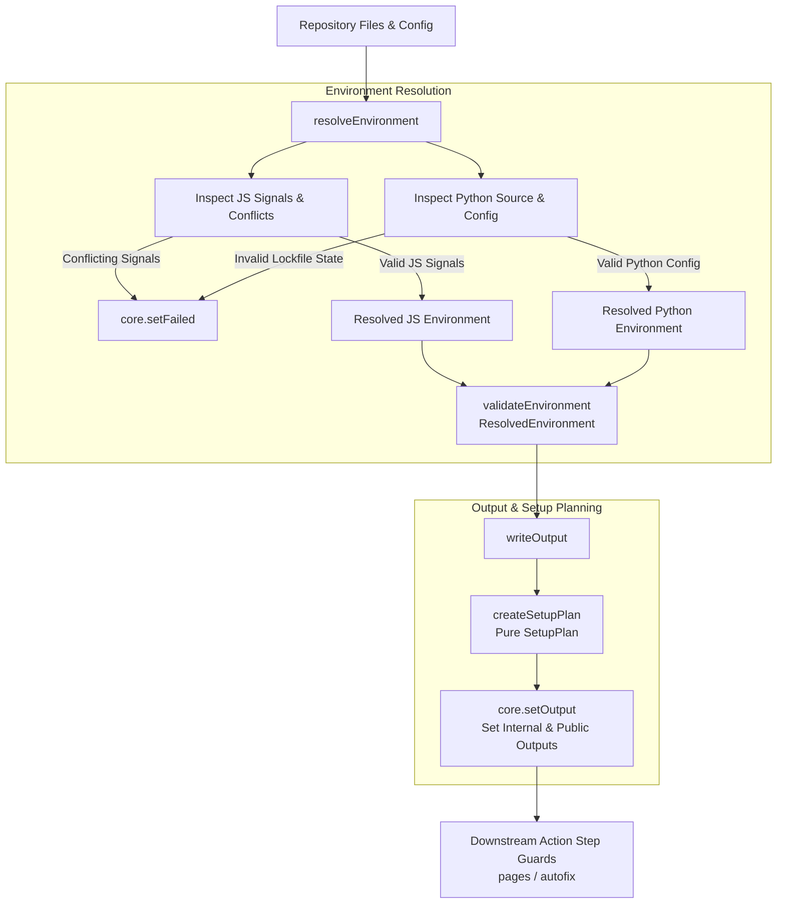

# Environment Resolution Algorithm Guide

This guide explains the design principles, decision flow, conflict handling, and maintenance rules for repository environment resolution in `@area44/workflows`.

---

## Purpose and Scope

Environment resolution is the initial phase of composite action execution (`pages` and `autofix`). It inspects repository configuration and source files, resolves the effective execution environment, derives a deterministic tool setup plan, and exports GitHub Actions outputs for downstream execution steps.

Environment resolution determines what runtimes and package managers a repository targets. Downstream composite action steps execute builds, dependency installations, and autofix commands based on the exported outputs without mutating repository files.

---

## Core Principles

- **Domain Independence**: JavaScript/TypeScript and Python project resolution operate as independent domains. Repositories can contain JavaScript, Python, both, or neither.
- **Explicit Conflict Validation**: Contradictory configuration declarations across manifest files, version files, and package managers trigger immediate validation errors (`core.setFailed`) rather than applying silent tie-breakers.
- **Pure Setup Planning**: Environment resolution and filesystem inspection are strictly separated from setup plan generation. `createSetupPlan(env)` is a pure, deterministic function with zero filesystem access or action side effects.
- **Explicit Specifier Preservation**: Explicitly declared version specifiers (such as `latest` or exact pins) are preserved through resolution rather than overwritten by defaults.
- **Deterministic Fallbacks**: When project files are detected without explicit version declarations, deterministic baseline defaults are applied (`node@24`, `python@3.12`, `bun@1.4`, `npm@12`).

---

## Resolution Algorithm

The resolution entrypoint (`run()` in `src/resolve-environment.ts`) executes environment inspection, validation, setup planning, and output writing sequentially:

### Flow Execution Order

1. **Domain Signal Inspection**: `inspectJsProjectEnvironment()` and `findPythonProjectContext()` collect package manifests (`package.json`, `pyproject.toml`), version files (`.nvmrc`, `.node-version`, `.bun-version`, `.python-version`, `runtime.txt`), lockfiles (`pnpm-lock.yaml`, `package-lock.json`, `bun.lock`, `uv.lock`), and Python source files (`.py`/`.pyi`).
2. **Conflict Validation & Resolution**: `validateRuntimeConflicts()` enforces consistency across runtime signals. If valid, `resolveJsEnvironment()` resolves JavaScript runtime (`node` or `bun`), package manager (`npm`, `pnpm`, `bun`), versions, and toolchain (`vite` or `vite-plus`). `resolvePythonEnvironment()` resolves Python version, package manager (`uv` or `pip`), and Ruff version pins.
3. **Aggregate Environment Validation**: `resolveEnvironment()` combines domain outcomes into a `ResolvedEnvironment` object and validates its structure via `validateEnvironment()`. Any structural or invariant violation throws an error.
4. **Setup Planning & Output Export**: `writeOutput(env)` passes the aggregate environment to `createSetupPlan(env)` to generate the pure `SetupPlan`. It then invokes `core.setOutput()` to export internal setup control outputs (such as `setup-node`, `setup-bun`, `setup-pnpm`, `setup-python`) and public ecosystem outputs.
5. **Action Step Guard Evaluation**: Downstream composite action steps evaluate output conditions (e.g. `if: steps.resolve_environment.outputs.setup-pnpm == 'true'`) to conditionally provision toolchains and execute project workflows.

---

## Conflict Handling

The algorithm distinguishes clearly between missing information (handled by deterministic fallbacks) and invalid or contradictory configuration (which halts step execution):

- **Successful Resolution**: Valid, non-contradictory configuration signals are resolved to explicit runtime, package manager, version, and toolchain settings.
- **Missing Information**: Absent manifest files or unspecified versions fall back to deterministic default versions without error.
- **Conflicting Signals**: Contradictory declarations (such as specifying both `devEngines.node` and `devEngines.bun`, or pairing `.bun-version` with `devEngines.node`) fail validation immediately and halt execution via `core.setFailed()`.
- **Invalid Configuration State**: Invariant failures (such as a `uv.lock` file existing without a valid `pyproject.toml` project configuration) trigger explicit error messages and halt execution.

---

## Maintenance

When modifying or extending the environment resolution algorithm:

- **Implementation as Authority**: The source code in `src/resolve-environment.ts`, `src/javascript-env.ts`, `src/python-env.ts`, and `src/setup-plan.ts` serves as the authoritative behavior specification.
- **Automated Test Coverage**: Specific precedence combinations, edge cases, and error messages are covered exhaustively by automated test suites in `__tests__/`. Add or update tests when resolution logic changes.
- **Documentation Synchronization**: Keep the Mermaid flowchart and core principles in this document synchronized with implementation changes, and ensure README references in `README.md`, `pages/README.md`, and `autofix/README.md` remain accurate.
