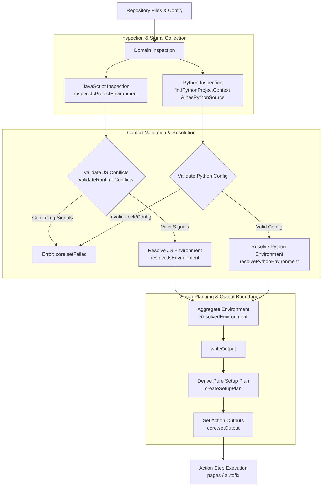

# Environment Resolution Algorithm Guide

This guide explains the design principles, decision flow, conflict handling, and maintenance rules for repository environment resolution in `@area44/workflows`.

---

## 1. Purpose and Scope

Environment resolution is the initial phase of composite action execution (`pages` and `autofix`). It inspects a repository's configuration and source files, resolves the effective execution environment, derives a deterministic tool setup plan, and exports GitHub Actions outputs for downstream execution steps.

### What Resolution Does

- Detects JavaScript/TypeScript and Python projects independently.
- Validates configuration signals for conflicting declarations.
- Resolves target runtimes (`node`, `bun`), package managers (`npm`, `pnpm`, `bun`, `uv`, `pip`), versions, and toolchains (`vite`, `vite-plus`).
- Generates a pure setup plan determining which setup actions (`actions/setup-node`, `oven-sh/setup-bun`, `pnpm/setup`, `astral-sh/setup-uv`, `actions/setup-python`, `voidzero-dev/setup-vp`) must run.
- Exposes internal setup control outputs and public ecosystem outputs to GitHub Actions workflow steps.

### What Resolution Does Not Do

- Does not execute site builds, dependency installations, or lint/format fixes (handled by downstream action steps).
- Does not mutate repository configuration or manifest files.
- Does not attempt to guess developer intent when contradictory runtime configuration exists.

---

## 2. Core Principles

1. **Domain Independence**: JavaScript/TypeScript and Python resolution operate as independent domains. A repository can be pure JS, pure Python, mixed JS/Python, or contain neither.
2. **Explicit Conflict Validation**: Contradictory configuration signals (e.g., declaring `devEngines.node` alongside `devEngines.bun` or pairing `.bun-version` with `devEngines.node`) trigger immediate validation errors rather than applying silent tie-breakers.
3. **Pure Setup Planning**: Environment resolution and filesystem inspection are strictly separated from setup plan construction. `createSetupPlan(env)` is a pure, deterministic function with zero filesystem access or side-effects.
4. **Explicit Specifier Preservation**: Explicitly declared version specifiers (including `latest` or exact pins like `bun@latest` or `ruff==0.4.2`) are preserved through resolution rather than overwritten by defaults.
5. **Deterministic Defaults**: When configuration files exist without explicit version specifiers, deterministic fallback defaults (`node@24`, `python@3.12`, `bun@1.4`, `npm@12`) are applied.

---

## 3. Resolution Flow

The following Mermaid flowchart illustrates the resolution pipeline from repository discovery through setup planning and output generation:



### Resolution Pipeline Stages

1. **Domain Inspection & Signal Collection**:
   - **JavaScript**: Inspects `package.json` (`packageManager`, `devEngines`, `dependencies`), version files (`.nvmrc`, `.node-version`, `.bun-version`), and lockfiles (`pnpm-lock.yaml`, `package-lock.json`, `bun.lock`).
   - **Python**: Scans for Python source files (`.py`/`.pyi`) outside excluded directories (`.git`, `.venv`, `node_modules`, `dist`, `build`, `__pycache__`, etc.) and collects manifests/lockfiles (`pyproject.toml`, `uv.toml`, `uv.lock`, `requirements.txt`, `.python-version`, `runtime.txt`).

2. **Conflict Validation & Domain Resolution**:
   - **JavaScript**: `validateRuntimeConflicts()` checks for contradictory runtime signals across `devEngines`, version files, and package managers. If valid, `resolveJsEnvironment()` applies strict precedence (`devEngines` > Version files > Package manager > Default fallback) to select runtime (`node` or `bun`), package manager (`npm`, `pnpm`, `bun`), versions, and toolchain (`vite` or `vite-plus`).
   - **Python**: Validates lockfile invariants (e.g., `uv.lock` requires a valid `pyproject.toml` project configuration). `resolvePythonEnvironment()` resolves Python version, package manager (`uv` or `pip`), and Ruff version pins.

3. **Aggregate Environment Construction**:
   - `resolveEnvironment()` combines domain outcomes into an aggregate `ResolvedEnvironment` object `{ javascript, python }` and validates its structure via `validateEnvironment()`.

4. **Setup Planning & Output Writing**:
   - `writeOutput(env)` passes the aggregate environment to `createSetupPlan(env)` to generate the pure `SetupPlan`.
   - Sets internal setup control outputs (`setup-node`, `setup-bun`, `setup-pnpm`, `setup-python`, `node-version`, `bun-version`, `pnpm-runtime`) and public ecosystem outputs (`javascript-detected`, `javascript-runtime`, `python-detected`, `python-package-manager`, `ruff-version`, etc.).

5. **Action Step Execution**:
   - Composite actions (`pages/action.yml` and `autofix/action.yml`) evaluate output guards (e.g., `if: steps.resolve_environment.outputs.setup-pnpm == 'true'`) to conditionally execute tool provisioners (`pnpm/setup`, `oven-sh/setup-bun`, `actions/setup-node`, `astral-sh/setup-uv`, `actions/setup-python`, `voidzero-dev/setup-vp`, `astral-sh/ruff-action`).

---

## 4. Conflict Handling

The resolution pipeline explicitly distinguishes between missing information (which triggers fallback defaults) and invalid or contradictory configuration (which halts execution with a detailed error message).

### Resolution Outcomes

| Scenario Category             | System Behavior                                                                 | Example Case                                                 | Outcome                                                      |
| ----------------------------- | ------------------------------------------------------------------------------- | ------------------------------------------------------------ | ------------------------------------------------------------ |
| **Successful Resolution**     | Valid signals resolved using explicit specifiers or precedence rules.           | `packageManager: "pnpm@12.15.0"` and `.nvmrc: "22.11.0"`     | Resolves Node 22.11.0, pnpm 12.15.0.                         |
| **Missing Information**       | Missing version specifiers or absent manifest files use deterministic defaults. | JS project with `package.json` but no version files.         | Defaults to Node 24, npm 12.                                 |
| **Conflicting Configuration** | Incompatible declarations across files trigger immediate validation failure.    | `.bun-version` paired with `package.json` `devEngines.node`. | Throws explicit error and halts step via `core.setFailed()`. |
| **Invalid Lockfile State**    | Lockfile present without required project configuration.                        | `uv.lock` present without valid `pyproject.toml` manifest.   | Throws explicit error requiring valid `pyproject.toml`.      |

---

## 5. Outputs and Setup Planning

The system maintains a clear conceptual boundary between environment resolution, setup planning, and output writing:

```
[Repository State] ──► Environment Resolution ──► [ResolvedEnvironment]
                                                        │
                                                        ▼
[Action Steps] ◄── GitHub Action Outputs ◄── Output Writing ◄── Setup Planning (Pure)
```

- **Environment Resolution** (`src/javascript-env.ts`, `src/python-env.ts`): Determines the repository's effective state based on filesystem analysis.
- **Setup Planning** (`src/setup-plan.ts`): Pure logic mapping `ResolvedEnvironment` to `SetupPlan` (`node`, `bun`, `pnpm`). Determines which setup actions must run (e.g. `pnpm/setup` manages runtime setup when PNPM is selected, disabling standalone `actions/setup-node`).
- **Output Writing** (`src/resolve-environment.ts`): Translates `ResolvedEnvironment` and `SetupPlan` into string outputs via `@actions/core.setOutput()`. Internal setup control outputs guide conditional action step execution, while public ecosystem outputs provide context to workflow consumers.

---

## 6. Maintenance Guidance

When modifying environment resolution algorithms or adding support for new ecosystem tools:

1. **Source Code Location**:
   - JavaScript/TypeScript logic: [`src/javascript-env.ts`](../src/javascript-env.ts)
   - Python/Ruff logic: [`src/python-env.ts`](../src/python-env.ts)
   - Setup planning: [`src/setup-plan.ts`](../src/setup-plan.ts)
   - Resolution entrypoint & outputs: [`src/resolve-environment.ts`](../src/resolve-environment.ts)
2. **Behavioral Test Verification**:
   - Place exhaustive edge-case coverage and scenario assertions in unit and integration test suites (`__tests__/`) rather than expanding documentation decision tables.
   - Run local validation commands: `npm run lint`, `npm run format --check`, `npm run build`, and `npm test`.
3. **Documentation Synchronization**:
   - Keep the Mermaid flowchart, core principles, and conflict handling rules in this document synchronized with implementation changes.
   - Ensure public action contracts in `pages/action.yml`, `autofix/action.yml`, `pages/README.md`, and `autofix/README.md` remain accurate.
